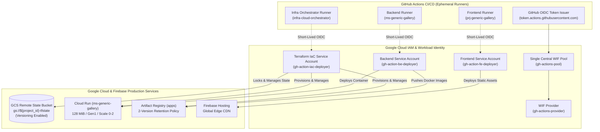
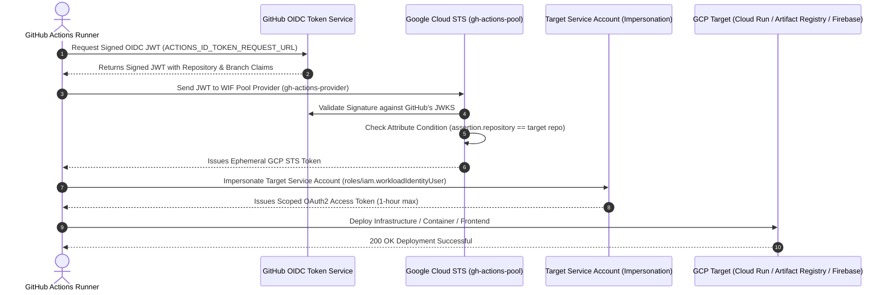

# ☁️ Cloud Infrastructure Orchestrator

[](https://www.terraform.io/)
[](https://cloud.google.com/)
[](https://cloud.google.com/storage)
[](https://cloud.google.com/artifact-registry)
[-00B0FF>)](https://cloud.google.com/iam/docs/workload-identity-federation)
[](LICENSE)

Production-ready Terraform Infrastructure as Code (IaC) orchestrating **Google Cloud Platform (GCP)** and **Firebase Hosting**. Implements **Workload Identity Federation (WIF)**, **GCS Remote State Backend with Versioning & Atomic Locking**, **128 MiB Cloud Run micro-footprint**, and **Automated 2-Version Artifact Registry cleanup policies** without static JSON service account keys.

---

## 🏛️ Ecosystem Architecture: Unified Keyless WIF Pool



---

## 🔐 The "No Fluff" Truth About Secrets

### Why Traditional Secrets Are an Antipattern

In legacy CI/CD pipelines, engineers create Google Cloud Service Account keys (`credentials.json`), base64-encode them, and paste them into GitHub Repository Secrets. This creates severe enterprise liabilities:

1. **Permanent Credentials**: The key never expires unless manually deleted.
2. **Exfiltration Liability**: If a runner is compromised or a build step leaks environment variables, attackers gain persistent, unrestricted cloud access.
3. **Operational Overhead**: Enterprise policies mandate 90-day key rotations, frequently causing inadvertent deployment downtime.

### How Workload Identity Federation (WIF) Works Cryptographically

With Workload Identity Federation, **zero private keys and zero passwords exist**:

| Dimension             | Legacy Service Account Keys                   | Keyless WIF (This Architecture)                                         |
| :-------------------- | :-------------------------------------------- | :---------------------------------------------------------------------- |
| **Storage in GitHub** | Plaintext base64 `.json` private key          | **Zero private keys**. Only public resource identifiers                 |
| **Token Lifetime**    | Infinite (multi-year) until revoked           | **Short-lived federated token (15–60 minutes)**                         |
| **Exfiltration Risk** | High: usable from any machine on the internet | **Zero**: Token cannot be reused outside runner or after timeout        |
| **Key Rotation**      | Manual rotation required every 90 days        | **Zero maintenance**: Handled automatically via asymmetric cryptography |
| **Fork / PR Abuse**   | Vulnerable to malicious workflows             | **Blocked**: GCP verifies `assertion.repository` before granting token  |



---

## 🌟 Enterprise Engineering Wins

### 1. 🔑 Zero JSON Service Account Keys Forever

- **OIDC Token Exchange**: Ephemeral GitHub Actions runners authenticate dynamically by exchanging short-lived JWT tokens with Google's Security Token Service (`sts.googleapis.com`).
- Eliminates service account key generation, downloading, and annual rotation risks.
- If a GitHub runner is compromised, no static credentials or `.json` keys exist to be leaked.

### 2. 🗄️ Resilient GCS Remote State Management

- **Persistent Cloud Storage Backend (`gs://${project_id}-tfstate`)**: Backed by a dedicated GCS bucket with **Object Versioning** enabled.
- **Solves Ephemeral Runner Drift**: GitHub Actions runners are ephemeral; storing state in GCS eliminates `Error 409: Resource already exists` conflicts and guarantees atomic state locking via Google Cloud Storage.
- **Dynamic Project Configuration**: Initialized dynamically via:
  ```bash
  terraform init -backend-config="bucket=${GCP_PROJECT_ID}-tfstate"
  ```
  The code contains **zero hardcoded bucket names**, making it reusable across any GCP environment.

### 3. 📦 Automated 2-Version Artifact Registry Cleanup Policy

- Configured with native GCP declarative `cleanup_policies` on `google_artifact_registry_repository.apps_docker`.
- Automatically enforces `keep_count = 2` for tagged release images and deletes stale untagged layer manifests daily, preventing storage quota exhaustion and reducing GCP billing.

### 4. ⚡ 128 MiB Cloud Run Service Orchestration

- Declaratively provisions `google_cloud_run_v2_service.backend` with **128 MiB** memory and **1000m CPU**.
- Sets `execution_environment = "EXECUTION_ENVIRONMENT_GEN1"` and request-based CPU allocation (`cpu_idle = true`).
- Configures scale-to-zero (`min_instance_count = 0`, `max_instance_count = 2`), ensuring $0 idle hosting cost.
- Explicit container port binding: binds via `ports { container_port = 3000 }` avoiding Cloud Run reserved environment variable conflicts.

### 5. 🎯 Granular Least-Privilege IAM Roles

| Service Account              | Role Scope                                                                    | Justification                                                                                            |
| :--------------------------- | :---------------------------------------------------------------------------- | :------------------------------------------------------------------------------------------------------- |
| **`gh-action-fe-deployer`**  | `roles/firebasehosting.admin`<br>`roles/serviceusage.serviceUsageConsumer`    | Deploys static Angular bundles to Firebase Hosting CDN and inspects enabled APIs.                        |
| **`gh-action-be-deployer`**  | `roles/run.admin`<br>`roles/artifactregistry.writer`<br>`roles/storage.admin` | Pushes Node 26 Docker images to Artifact Registry, deploys Cloud Run revisions, and prunes old versions. |
| **`gh-action-iac-deployer`** | Fine-grained IaC Admin / `roles/owner`                                        | Provisions infrastructure, manages IAM bindings, and locks GCS state bucket.                             |

---

## 🔒 Shift-Left Pre-Commit Architecture

Infrastructure changes are validated locally on the engineer's machine via `.husky/pre-commit`:

1. **`lint-staged`**: Enforces Prettier formatting on markdown, YAML, and JSON files.
2. **`terraform fmt -check`**: Validates canonical HCL formatting across all `.tf` manifests.

Any non-standard HCL formatting or unformatted configuration blocks the commit before it can reach remote CI.

---

## 📁 Repository Structure & Scaffold

```text
infra-cloud-orchestrator/
├── .husky/
│   ├── pre-commit             # Shift-left quality gate (lint-staged + terraform fmt -check)
│   └── commit-msg             # Conventional commit validation
├── .github/workflows/
│   ├── ci.yml                 # PR quality gate (terraform fmt, init, validate)
│   └── provision-infra.yml    # Parameterized workflow dispatch to plan/apply via GCS state
├── versions.tf                # Terraform (~> 1.11), Google (~> 5.0), GitHub (~> 6.0), and GCS backend
├── variables.tf               # Parameterized variables (memory, cpu, scaling, retention, repos)
├── main.tf                    # APIs enablement & conditional Workload Identity Pool / Provider
├── frontend.tf                # Frontend Deployer SA, Firebase Hosting IAM & WIF binding
├── backend.tf                 # Backend Deployer SA, Cloud Run (128Mi), & Artifact Registry
├── github_secrets.tf          # Auto-provisions encrypted GitHub Actions repository secrets
├── outputs.tf                 # Emits Provider, SA emails, and bucket resource names
├── terraform.tfvars.example   # Reusable configuration template
└── README.md                  # Comprehensive architectural guide & runbooks
```

---

## 🚀 Quickstart & Deployment Guide

### 1. Prerequisites

- **Terraform** >= 1.10.0 (tested on 1.11.x)
- **Google Cloud SDK (`gcloud`)** authenticated with admin privileges:
  ```bash
  gcloud auth login
  gcloud auth application-default login
  gcloud config set project YOUR_PROJECT_ID
  ```
- **GitHub Personal Access Token** with `repo` scope (allows Terraform to automatically provision encrypted repository secrets in your GitHub repos).

### 2. Configure Variables

Copy the example variables file:

```bash
cp terraform.tfvars.example terraform.tfvars
```

Edit `terraform.tfvars`:

```hcl
project_id         = "your-gcp-project-id"
project_number     = "123456789012"
github_org         = "your-github-org"
frontend_repo_name = "prj-generic-gallery"
backend_repo_name  = "ms-generic-gallery"

# Workload Identity Pool
create_pool        = true
pool_id            = "gh-actions-pool"
provider_id        = "gh-actions-provider"

# Automated GitHub Secrets provisioning
enable_github_secrets = true

# Cloud Run Configuration
cloud_run_memory      = "128Mi"
cloud_run_cpu         = "1000m"
cloud_run_max_scale   = 2
artifact_keep_count   = 2
```

### 3. Initialize with GCS Remote State

```bash
# Initialize Terraform pointing to your persistent GCS state bucket
terraform init -backend-config="bucket=${GCP_PROJECT_ID}-tfstate"

# Validate configuration syntax
terraform validate
```

### 4. Review Plan & Apply

```bash
export GITHUB_TOKEN="ghp_your_github_personal_access_token"

# Review proposed infrastructure changes
terraform plan

# Apply changes to GCP and GitHub
terraform apply
```

### 5. Automated GitHub Secrets

When `terraform apply` finishes, it automatically creates encrypted repository secrets in your GitHub repositories. Notice that **none of these values are passwords or private keys**:

1. **Frontend Repository Secrets (`prj-generic-gallery`)**:
   - `WORKLOAD_IDENTITY_PROVIDER`: `projects/<PROJECT_NUMBER>/locations/global/workloadIdentityPools/<POOL_ID>/providers/<PROVIDER_ID>`
   - `FIREBASE_SERVICE_ACCOUNT_EMAIL`: `gh-action-fe-deployer@<PROJECT_ID>.iam.gserviceaccount.com`
   - `GCP_PROJECT_ID`: `<PROJECT_ID>`
2. **Backend Repository Secrets (`ms-generic-gallery`)**:
   - `DEV_STG_WORKLOAD_IDENTITY_PROVIDER`: `projects/<PROJECT_NUMBER>/locations/global/workloadIdentityPools/<POOL_ID>/providers/<PROVIDER_ID>`
   - `DEV_STG_WIP_SA`: `gh-action-be-deployer@<PROJECT_ID>.iam.gserviceaccount.com`
   - `DEV_STG_PROJECT_ID`: `<PROJECT_ID>`

---

## 🔒 GitHub Actions Deployment Example (Keyless WIF)

Here is how your Frontend and Backend deployment workflows authenticate without static keys:

```yaml
jobs:
  deploy:
    runs-on: ubuntu-latest
    permissions:
      contents: read
      id-token: write # Required for Workload Identity Federation

    steps:
      - name: Checkout Code
        uses: actions/checkout@v4

      - name: Authenticate to Google Cloud (Keyless WIF)
        id: auth
        uses: google-github-actions/auth@v2
        with:
          project_id: ${{ secrets.GCP_PROJECT_ID }}
          workload_identity_provider: ${{ secrets.WORKLOAD_IDENTITY_PROVIDER }}
          service_account: ${{ secrets.FIREBASE_SERVICE_ACCOUNT_EMAIL }}
          create_credentials_file: true

      - name: Deploy to Firebase Hosting
        env:
          GOOGLE_APPLICATION_CREDENTIALS: ${{ steps.auth.outputs.credentials_file_path }}
        run: npx firebase-tools deploy --only hosting --project ${{ secrets.GCP_PROJECT_ID }}
```

---

## ❓ FAQ & Troubleshooting

### Q: Why do we include `roles/serviceusage.serviceUsageConsumer`?

`firebase-tools` >= 15.35.0 queries `serviceusage.googleapis.com` before deployments to verify enabled APIs. Without this role, Firebase deploys fail with HTTP 403 Forbidden.

### Q: Why does Terraform use a GCS remote state backend?

GitHub Actions runners are ephemeral. Without remote state persistence, each runner runs `terraform apply` with an empty state, triggering `Error 409: Resource already exists`. The GCS backend `gs://${project_id}-tfstate` guarantees persistent, atomic state management across all runs.

### Q: How do I onboard another project?

Copy `terraform.tfvars.example` to `my-project.tfvars`, set `create_pool = true`, populate the new Project ID and Project Number, and run:

```bash
terraform init -backend-config="bucket=my-project-tfstate"
terraform apply -var-file="my-project.tfvars"
```

---

## 📄 License

MIT © [Himanshu Saraswat](https://github.com/himanshusaraswat)
