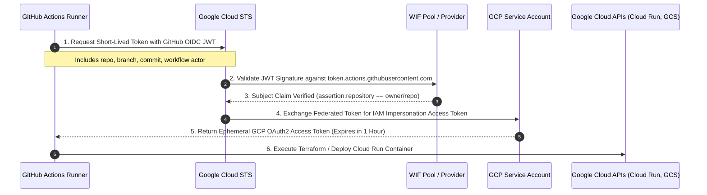
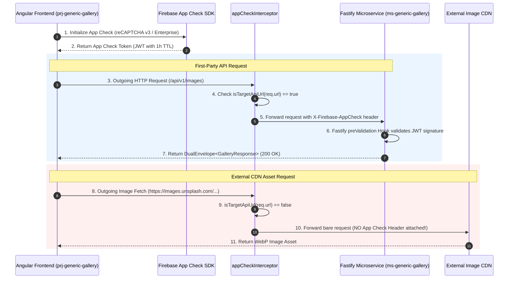

# 🌐 System Knowledge Graph: Generic Gallery Platform

Welcome to the central, living **System Knowledge Graph** for the Generic Gallery Platform. This document serves as the single relational source of truth across all three repositories in the workspace:

1. **[`prj-generic-gallery`](file:///Users/himanshusaraswat/workspace_hs/prj-generic-gallery/README.md)**: Angular 22 Zoneless + Signals frontend on Firebase Hosting.
2. **[`ms-generic-gallery`](file:///Users/himanshusaraswat/workspace_hs/ms-generic-gallery/README.md)**: Fastify 5 + Node 26 microservice on Google Cloud Run (128 MiB budget).
3. **[`infra-cloud-orchestrator`](file:///Users/himanshusaraswat/workspace_hs/infra-cloud-orchestrator/README.md)**: Terraform 1.11 Infrastructure as Code provisioning Google Cloud resources with Keyless Workload Identity Federation (WIF).

---

## 🏛️ Panoramic System Architecture & Topology

```mermaid
flowchart TD
    subgraph ClientLayer["1. Client Layer (Browser)"]
        SPA["prj-generic-gallery\nAngular 22 Zoneless + Signals"]
        AC_CLIENT["Firebase App Check SDK\n(reCAPTCHA Enterprise / Debug Token)"]
    end

    subgraph CDNLayer["2. Edge & Ingress Layer"]
        FIREBASE_HOSTING["Firebase Hosting\nGlobal CDN Ingress"]
        CUSTOM_DOMAIN["Custom Domain / Firebase Rewrite Rules"]
    end

    subgraph ServiceLayer["3. Microservice Layer (Google Cloud Run)"]
        CR_INSTANCE["ms-generic-gallery\nFastify 5 + Node 26 (128 MiB RAM)"]
        AC_PLUGIN["@fastify/app-check Verification Hook\n(Enforced on /api/*, Bypassed on /health)"]
        CIRCUIT_BREAKER["Fastify Circuit Breaker & Rate Limiter"]
    end

    subgraph DataLayer["4. Data & External Services"]
        MONGO_ATLAS["MongoDB Atlas\nDocument Storage (Cluster)"]
        EXTERNAL_CDN["Public CDNs (Unsplash, Picsum)\n(Token Stripping Enforced)"]
    end

    subgraph SecurityLayer["5. Identity & Access Governance"]
        GH_ACTIONS["GitHub Actions Runners\n(OIDC Token Issuer)"]
        GCP_STS["Google Cloud STS\nSecurity Token Service"]
        WIF_POOL["Workload Identity Federation Pool\n(Zero Static Secrets)"]
        SERVICE_ACCOUNTS["GCP Service Accounts\n(Principle of Least Privilege)"]
    end

    subgraph IaCLayer["6. Infrastructure as Code Layer"]
        TERRAFORM["infra-cloud-orchestrator\nTerraform 1.11 Engine"]
        GCS_BACKEND["GCS State Bucket\n(Object Versioning Enabled)"]
        ARTIFACT_REGISTRY["Google Artifact Registry\n(Docker Image Repository, 2-Version Retention)"]
    end

    SPA -->|Serves Static Assets| FIREBASE_HOSTING
    SPA -->|Acquires Token| AC_CLIENT
    SPA -->|Authenticated API Requests\nX-Firebase-AppCheck| CR_INSTANCE
    SPA -->|Safe Image Fetches (No App Check Header)| EXTERNAL_CDN

    CR_INSTANCE -->|Verifies Token| AC_PLUGIN
    CR_INSTANCE -->|Read/Write Operations| MONGO_ATLAS

    GH_ACTIONS -->|OIDC JWT| GCP_STS
    GCP_STS -->|Federated Token| WIF_POOL
    WIF_POOL -->|Impersonates| SERVICE_ACCOUNTS

    TERRAFORM -->|Manages State| GCS_BACKEND
    TERRAFORM -->|Provisions & Configures| CR_INSTANCE
    TERRAFORM -->|Provisions & Cleans| ARTIFACT_REGISTRY
    TERRAFORM -->|Configures Bindings| WIF_POOL
```

---

## 🔒 Security Handshakes & Sequence Flows

### 1. Zero-Secret Workload Identity Federation (WIF) OIDC Handshake

All CI/CD deployments and Terraform operations use cryptographic OIDC exchange with Google Cloud STS, eliminating static Service Account JSON keys.



### 2. End-to-End Firebase App Check Token Lifecycle

Protects backend resources against API scraping, bots, and unauthorized clients.



---

## 📋 Cross-Repository Contract Registry

### 1. Standard Response DTO: `DualEnvelope<T>`

All JSON API endpoints in `ms-generic-gallery` return the standardized `DualEnvelope<T>` payload consumed by `prj-generic-gallery`:

```typescript
export interface DualEnvelope<T> {
  success: boolean;
  data: T | null;
  error?: {
    code: string;
    message: string;
    details?: unknown;
  };
  metadata: {
    timestamp: string;
    requestId: string;
    version: string;
    environment: 'development' | 'staging' | 'production';
  };
}
```

### 2. API Endpoints Catalog

| Route                | HTTP Method |  App Check Required?  | Request Schema                       | Response Payload                                 | Description                                |
| :------------------- | :---------: | :-------------------: | :----------------------------------- | :----------------------------------------------- | :----------------------------------------- |
| `/health`            |    `GET`    | ❌ **No (Bypassed)**  | None                                 | `DualEnvelope<{ status: 'ok', uptime: number }>` | Cloud Run startup & liveness probe         |
| `/api/v1/images`     |    `GET`    | ✅ **Yes (Enforced)** | `?page=1&limit=20&tag=nature`        | `DualEnvelope<PaginatedImages>`                  | Paginated gallery image list with metadata |
| `/api/v1/images/:id` |    `GET`    | ✅ **Yes (Enforced)** | Route Param `:id` (MongoDB ObjectId) | `DualEnvelope<GalleryImage>`                     | Single gallery item detail                 |
| `/api/v1/categories` |    `GET`    | ✅ **Yes (Enforced)** | None                                 | `DualEnvelope<Category[]>`                       | List of gallery categories                 |

---

## 🛡️ Invariants & Non-Negotiables Matrix (Policy as Code)

The following architectural constraints are **immutable**. AI agents and developers must never relax or violate these rules:

| Domain                    | Invariant                                                              | Enforcement Mechanism                                                                                     |
| :------------------------ | :--------------------------------------------------------------------- | :-------------------------------------------------------------------------------------------------------- |
| **Backend Cost & Sizing** | Memory ceiling **128 MiB**, `--max-old-space-size=90`                  | Cloud Run configuration in `infra-cloud-orchestrator/modules/cloud-run` + `ms-generic-gallery/Dockerfile` |
| **Backend Billing**       | Request-based CPU pricing (`cpu_idle = true`)                          | Terraform `google_cloud_run_v2_service` configuration                                                     |
| **Backend Testing**       | Minimum 24 passing unit tests covering all routes and plugins          | Pre-commit hook & GitHub Actions CI                                                                       |
| **Frontend Architecture** | **100% Zoneless** (`provideZonelessChangeDetection()`), zero `zone.js` | `prj-generic-gallery/src/app/app.config.ts`                                                               |
| **Frontend Signals**      | Signal primitives for state, `@angular/forms/signals` for forms        | Pre-commit typecheck and ESLint checks                                                                    |
| **Frontend Security**     | Zero `X-Firebase-AppCheck` leakage to external CDN domains             | `prj-generic-gallery/src/app/core/app-check.interceptor.ts` unit tests                                    |
| **Frontend Testing**      | Minimum 47 passing Vitest unit tests                                   | Pre-commit hook & GitHub Actions CI                                                                       |
| **Frontend Standards**    | Strict compliance with **Google Modern Web Guidance (MWG)**            | Native `<dialog>`, container queries, view transitions, WCAG 2.2 AA                                       |
| **Infrastructure IAM**    | **Zero Static Secrets**: Keyless WIF OIDC only                         | No `google_service_account_key` resources allowed in Terraform                                            |
| **Infrastructure State**  | Remote versioned GCS bucket with state locking                         | Terraform backend configuration                                                                           |
| **Public Documentation**  | **Zero PII & Zero Real GCP Project Numbers**                           | Sanitization script `check-doc-drift.mjs`                                                                 |
| **Branch Parity**         | `develop` and `main` fast-forward synchronized across all 3 repos      | Pre-push and release verification rules                                                                   |

---

## 🚦 Positive Application Whitelist & Path-Gating Matrix

To prevent wasteful CI runs and accidental production deployments, each repository implements strict path gating:

| Repository                     | Trigger Event                | Positive Application Whitelist (`paths:`)                                                   | Excluded Files (`paths-ignore:`)                                   | Behavior                                                             |
| :----------------------------- | :--------------------------- | :------------------------------------------------------------------------------------------ | :----------------------------------------------------------------- | :------------------------------------------------------------------- |
| **`prj-generic-gallery`**      | Push to `develop`            | `src/**`, `scripts/**`, `angular.json`, `package*.json`, `tsconfig*.json`, `firebase*.json` | Markdown, docs, `.husky` (implicit)                                | Triggers CI + Firebase Deploy on app changes; **No deploy on docs**  |
| **`ms-generic-gallery`**       | Push to `develop`            | `src/**`, `Dockerfile`, `.dockerignore`, `package*.json`, `tsconfig.json`                   | Markdown, docs, `.husky` (implicit)                                | Triggers CI + Cloud Run Deploy on app changes; **No deploy on docs** |
| **`infra-cloud-orchestrator`** | Push / PR `develop` & `main` | Terraform configurations                                                                    | `**.md`, `docs/**`, `.husky/**`, `LICENSE`, `.gitignore`, `.nvmrc` | Triggers Terraform CI; **Zero runs on docs**                         |

---

## 🔗 Repository Spoke Navigation

- 🎨 **Frontend Spoke**: [`prj-generic-gallery/AGENTS.md`](file:///Users/himanshusaraswat/workspace_hs/prj-generic-gallery/AGENTS.md)
  - Angular 22 Zoneless rules, Signal forms, Google MWG compliance, Vitest mocking.
- ⚡ **Backend Spoke**: [`ms-generic-gallery/AGENTS.md`](file:///Users/himanshusaraswat/workspace_hs/ms-generic-gallery/AGENTS.md)
  - Fastify 5 lifecycle, 128 MiB memory tuning, Zod contracts, App Check verification.
- ☁️ **Infrastructure Spoke**: [`infra-cloud-orchestrator/AGENTS.md`](file:///Users/himanshusaraswat/workspace_hs/infra-cloud-orchestrator/AGENTS.md)
  - Terraform 1.11 modules, Keyless WIF OIDC, Artifact Registry retention, GCS backend.
- 🔄 **Workspace Agent Governance**: [`workspace_hs/AGENTS.md`](file:///Users/himanshusaraswat/workspace_hs/AGENTS.md)
  - Atomic Code-Doc protocol, Zero-Drift validation, Multi-repo handoff rules.
